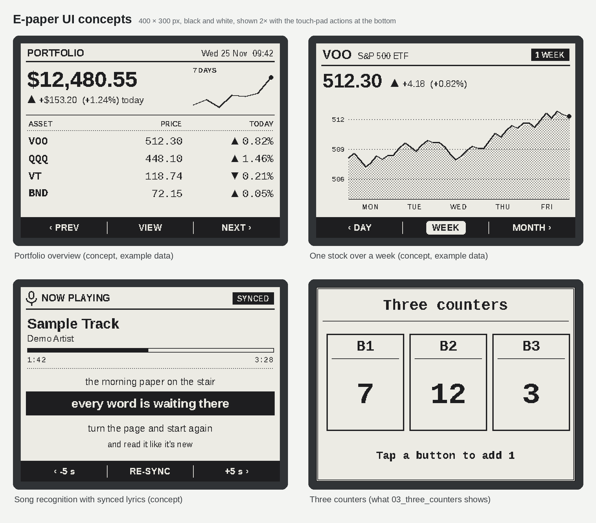
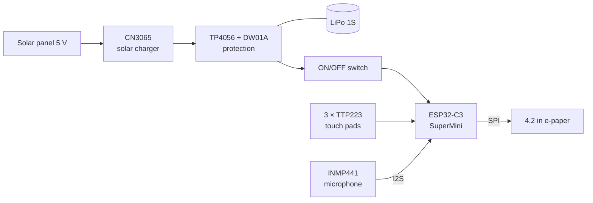
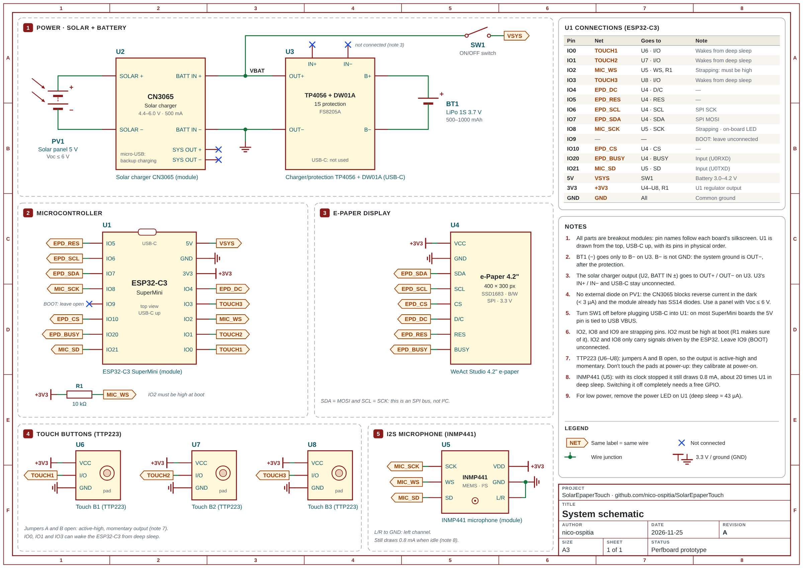

# SolarEpaperTouch

[](https://github.com/nico-ospitia/SolarEpaperTouch/actions/workflows/compile-firmware.yml)

A solar-powered desk display built around an **ESP32-C3**, a **4.2" e-paper** screen, three **capacitive touch buttons** and an **I2S microphone**. Every part is a ready-made module wired on perfboard: no custom PCB.



<sub>UI concepts drawn at the display's real resolution (400 × 300, black and white). The numbers are example data.</sub>

> **Status: prototype.** The schematic is at revision A, and the display and touch buttons work with the test sketches. The microphone, the application firmware and the enclosure come next.

## Why this design

- **E-paper** keeps its image with no power, so the screen costs nothing between updates.
- **ESP32-C3** spends most of its time in deep sleep and wakes on a timer or a touch.
- **Solar charging** tops up a small LiPo, so the device can sit on a desk without a cable.
- **Touch pads** work through the enclosure wall, so there are no holes for buttons.

## Planned uses

- **Portfolio tracker:** wake every few minutes, fetch prices for a list of stocks and ETFs over Wi-Fi, and show the total, the daily change and a weekly chart.
- **Song and lyrics:** tap a pad, record a few seconds with the microphone, identify the song through an online recognition service and show time-synced lyrics.

## Hardware

| Ref | Part | Role |
|---|---|---|
| U1 | ESP32-C3 SuperMini | Microcontroller with Wi-Fi |
| U2 | CN3065 solar charger module | Charges the battery from the panel |
| U3 | TP4056 + DW01A module | Battery protection (charger section unused) |
| U4 | WeAct Studio 4.2" e-paper | 400 × 300 black/white display, SPI |
| U5 | INMP441 | I2S MEMS microphone |
| U6–U8 | TTP223 | Capacitive touch buttons |
| PV1, BT1 | 5 V mini solar panel, 1S LiPo | Power |

Quantities, specs and search terms: [hardware/bom/bom.csv](hardware/bom/bom.csv).



## Schematic

[](hardware/schematic/SolarEpaperTouch_schematic_revA.pdf)

A3 [PDF](hardware/schematic/SolarEpaperTouch_schematic_revA.pdf) and [SVG](hardware/schematic/SolarEpaperTouch_schematic_revA.svg). Every connection as a table: [docs/wiring.md](docs/wiring.md).

### ESP32-C3 pin map

| GPIO | Signal | GPIO | Signal |
|---|---|---|---|
| IO0 | Touch pad 1 | IO6 | E-paper SCL (SPI clock) |
| IO1 | Touch pad 2 | IO7 | E-paper SDA (SPI data) |
| IO2 | Mic WS (+ 10 kΩ pull-up) | IO8 | Mic SCK |
| IO3 | Touch pad 3 | IO10 | E-paper CS |
| IO4 | E-paper D/C | IO20 | E-paper BUSY |
| IO5 | E-paper RES | IO21 | Mic SD |

IO9 (BOOT) stays unconnected. The board is powered from the battery through its 5V pin, and its 3V3 pin feeds every module.

## Firmware

Arduino IDE with the Espressif **esp32** core and the **GxEPD2** library. Setup steps and troubleshooting: [firmware/README.md](firmware/README.md).

| Sketch | What it does |
|---|---|
| [`01_epaper_counter`](firmware/01_epaper_counter) | Counter every 3 s, partial and full refresh |
| [`02_touch_buttons`](firmware/02_touch_buttons) | Counter controlled by the touch pads |
| [`03_three_counters`](firmware/03_three_counters) | One counter per pad, redraws only the box that changed |

## Power

About **21 mAh a day** in portfolio mode (waking every 10 minutes), roughly five weeks on a 1000 mAh cell with no sun at all. The microphone is the catch: it draws 0.8 mA even when idle, which doubles that figure if it stays powered. Details, assumptions and how to measure: [docs/power-budget.md](docs/power-budget.md).

## Building it

Step-by-step bring-up, one block at a time: [docs/assembly.md](docs/assembly.md).

> Turn the power switch off before plugging USB into the ESP32. On most SuperMini boards the 5V pin is tied to USB power.

## Repository layout

```
SolarEpaperTouch/
├── firmware/          Arduino sketches (bring-up tests)
├── hardware/
│   ├── schematic/     Schematic, PDF and SVG
│   ├── bom/           Bill of materials (CSV)
│   └── enclosure/     3D-printed enclosure (to be added)
├── docs/              Wiring, power budget, assembly, images, photos
└── tools/             Scripts that generate the schematic and the UI images
```

## Roadmap

- [x] Schematic, revision A
- [x] E-paper and touch bring-up sketches
- [ ] Microphone test sketch (I2S sound level)
- [ ] Deep sleep with wake-up from the touch pads
- [ ] Portfolio tracker firmware
- [ ] Song recognition and synced lyrics
- [ ] Enclosure 3D model (STEP and STL)
- [ ] Measure sleep current and solar charging on the desk
- [ ] Photos of the build

## License

[MIT](LICENSE)
